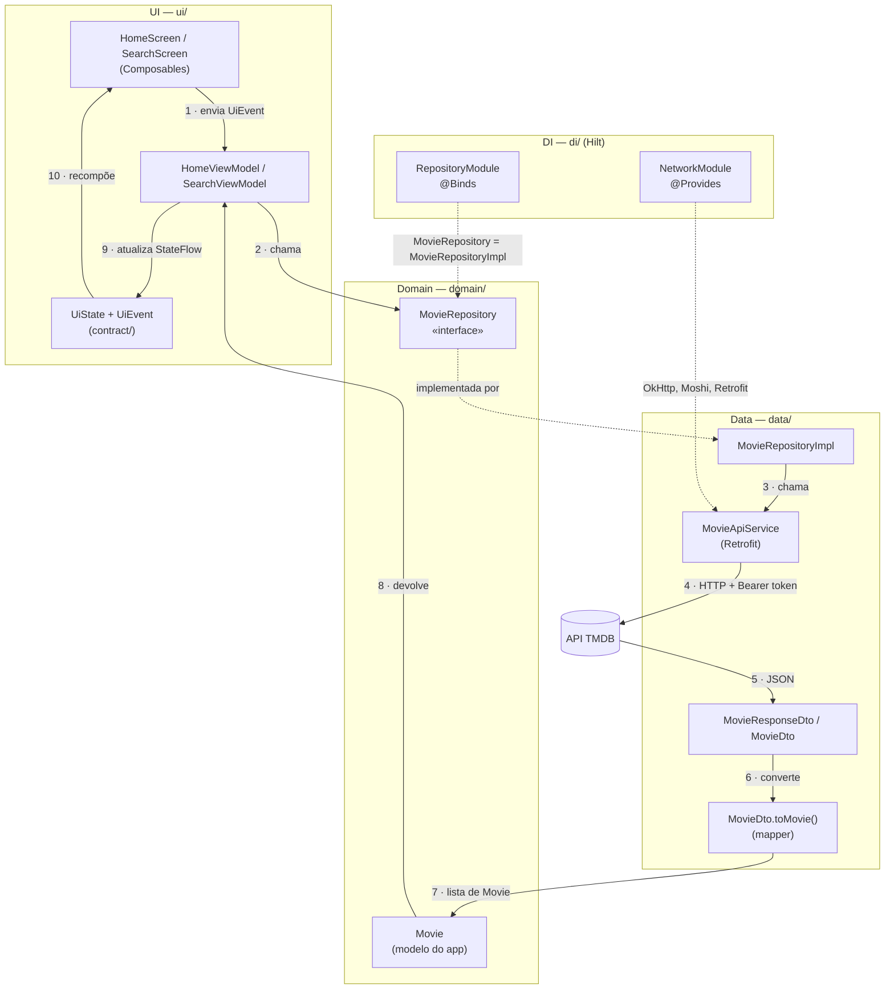

# Arquitetura do CineLog

Este documento explica **por que** o código está dividido em camadas e qual é o papel de
cada peça. A configuração da API (token, endpoints, DTOs) está em
[feature-api.md](feature-api.md).

## Visão geral

O app segue três camadas. Cada uma conhece só a camada abaixo dela, e somente por
**contratos** (interfaces e modelos próprios):

| Camada | Pacote | Responsabilidade | Conhece |
| --- | --- | --- | --- |
| **UI** | `ui/` | Desenhar a tela e reagir ao usuário | `domain` |
| **Domain** | `domain/` | Definir *o que* o app faz (modelos e contratos) | ninguém |
| **Data** | `data/` | Definir *como* os dados são obtidos (rede, JSON) | `domain` |

O `di/` (Hilt) liga as camadas sem que uma precise criar a outra.

## Diagrama do fluxo



**Leitura do fluxo:** a tela envia um evento → o ViewModel pede filmes ao **contrato**
`MovieRepository` → o Hilt entrega a implementação real → ela chama a API → o JSON vira
DTO → o mapper converte para `Movie` → o ViewModel publica o novo estado → a tela redesenha.

## Por que cada peça existe

### `MovieRepository` (interface, em `domain/`)

É o **contrato**: diz *o que* pode ser pedido, sem dizer *como*.

```kotlin
interface MovieRepository {
    suspend fun getPopularMovies(): List<Movie>
    suspend fun getNowPlayingMovies(): List<Movie>
    suspend fun searchMovies(query: String, genreId: Int?): List<Movie>
}
```

Por que uma interface:

- **O ViewModel não depende de Retrofit.** Ele só conhece `MovieRepository` e `Movie`.
  Se a fonte de dados mudar, o ViewModel continua igual.
- **Testes ficam simples.** Num teste, você entrega um `FakeMovieRepository` que devolve
  uma lista fixa, sem internet e sem mock de HTTP.
- **Troca de fonte sem quebrar o app.** Dá para criar uma implementação com cache
  (Room) ou uma versão offline mantendo o mesmo contrato.

### `MovieRepositoryImpl` (classe, em `data/`)

É **o como**: a implementação concreta do contrato.

- Recebe `MovieApiService` por injeção (`@Inject constructor`).
- Decide qual endpoint chamar. Por exemplo, em `searchMovies` usa `search/movie`,
  `discover/movie` ou `movie/popular`, conforme o texto e o gênero.
- Converte `MovieDto` → `Movie` antes de devolver. **DTO nunca sai da camada `data`.**

O sufixo `Impl` deixa claro que essa é a implementação de uma interface com o nome base.

### `RepositoryModule` (`di/`)

O Hilt não sabe sozinho qual classe usar quando alguém pede uma interface. Este módulo
responde:

```kotlin
@Binds
@Singleton
abstract fun bindMovieRepository(impl: MovieRepositoryImpl): MovieRepository
```

> "Quando alguém pedir `MovieRepository`, entregue `MovieRepositoryImpl`."

`@Binds` é usado (e não `@Provides`) porque não há nada a construir manualmente: o Hilt
já sabe criar `MovieRepositoryImpl` pelo `@Inject constructor`. `@Singleton` faz o app
inteiro usar a mesma instância.

### `NetworkModule` (`di/`)

Fornece objetos de bibliotecas externas, que não têm `@Inject`: `OkHttpClient` (com o
interceptor do token), `Moshi`, `Retrofit` e o `MovieApiService` gerado pelo Retrofit.

### DTO × modelo de domínio

| | `MovieDto` (`data/`) | `Movie` (`domain/`) |
| --- | --- | --- |
| Formato | Espelha o JSON do TMDB | Só o que o app usa |
| Nomes | `poster_path`, `vote_average` | `posterUrl`, `voteAverage` |
| Dados | Caminho parcial da imagem | URL completa, já montada |
| Depende de | Moshi (`@Json`) | Nada |

Se o TMDB mudar um campo, só o DTO e o mapper mudam. A UI não percebe.

### Mapper (`MovieDto.toMovie()`)

Função de extensão que faz a conversão em um lugar só: título com fallback, URLs completas
de imagem, nota arredondada e textos nulos substituídos por valores seguros.

### ViewModel + `contract/` (UiState e UiEvent)

- **`UiState`**: uma `data class` imutável com *tudo* que a tela precisa desenhar
  (`isLoading`, `movies`, `errorMessage`...). A tela só lê.
- **`UiEvent`**: uma `sealed interface` com *tudo* que o usuário pode fazer
  (`OnQueryChange`, `OnRetryClicked`...). A tela só envia.
- **ViewModel**: recebe eventos em `onEvent()`, chama o repositório e publica o novo
  estado num `StateFlow`. Sobrevive à rotação de tela.

Assim o fluxo é **unidirecional**: evento sobe, estado desce.

### Screen × Content

Cada tela tem duas funções:

- `SearchScreen(viewModel = hiltViewModel())`: pega o ViewModel e observa o estado.
- `SearchContent(uiState, onEvent)`: só desenha, sem ViewModel.

Separar permite fazer `@Preview` de qualquer estado (carregando, vazio, erro) passando um
`UiState` manual.

## Exemplo completo: digitar na busca

1. O usuário digita "duna" no `SearchInput`.
2. `SearchScreen` envia `SearchUiEvent.OnQueryChange("duna")`.
3. `SearchViewModel` atualiza `query`, espera 400 ms (debounce) e cancela a busca anterior.
4. Chama `movieRepository.searchMovies("duna", genreId = null)`.
5. `MovieRepositoryImpl` chama `movieApiService.searchMovies("duna")`.
6. O OkHttp envia `GET search/movie?query=duna` com `Authorization: Bearer ...`.
7. O Moshi converte o JSON em `MovieResponseDto`, e o mapper converte para `List<Movie>`.
8. O ViewModel publica `SearchUiState(movies = [...], isLoading = false)`.
9. A tela recompõe: grade de resultados, `SearchEmptyMessage` se a lista vier vazia, ou
   `SearchErrorMessage` se houver exceção.

## Onde colocar código novo

| Preciso de... | Coloque em |
| --- | --- |
| Novo endpoint | `data/remote/api/MovieApiService.kt` |
| Novo campo vindo da API | `MovieDto` → mapper → `Movie` |
| Nova operação para as telas | `MovieRepository` (interface) + `MovieRepositoryImpl` |
| Novo estado/ação de tela | `ui/<tela>/contract/` |
| Componente visual reutilizável | `ui/<tela>/components/` ou `ui/components/` |
| Nova cor | `ui/theme/Color.kt`, com nome semântico |
