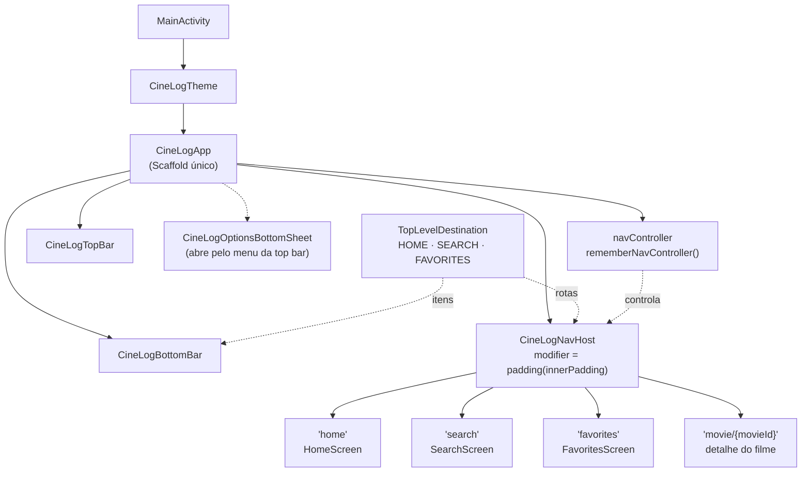
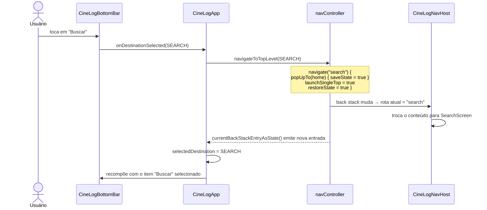
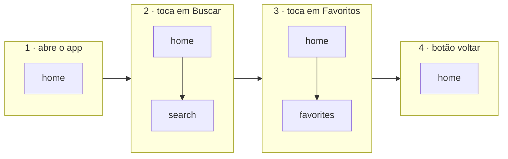
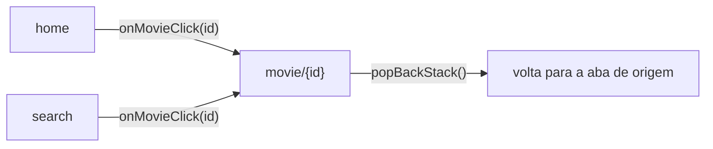

# Navegação do CineLog

Este documento explica como o app troca de tela pelo **bottom bar**. A visão geral das
camadas está em [architecture.md](architecture.md).

## Ideia central

O app tem **uma única casca**: a top bar e o bottom bar existem uma vez só, em
`CineLogApp`. As telas (`HomeScreen`, `SearchScreen`, `FavoritesScreen`) não têm
`Scaffold` próprio — elas são apenas o **conteúdo** que o `NavHost` troca no meio da tela.

```
┌──────────────────────────────┐
│  CineLogTopBar               │  ← fixa
├──────────────────────────────┤
│                              │
│  CineLogNavHost              │  ← só isso muda
│  (home / search / favorites) │
│                              │
├──────────────────────────────┤
│  CineLogBottomBar            │  ← fixa
└──────────────────────────────┘
```

## Peças envolvidas

| Arquivo | Papel |
| --- | --- |
| `MainActivity.kt` | Aplica o tema e chama `CineLogApp()` |
| `ui/CineLogApp.kt` | `Scaffold` único: top bar, bottom bar, bottom sheet de opções e o `navController` |
| `ui/navigation/TopLevelDestination.kt` | Enum com as abas: rota, label e ícone |
| `ui/components/CineLogBottomBar.kt` | Desenha um item por aba e avisa qual foi clicada — **não navega** |
| `ui/navigation/CineLogNavHost.kt` | Mapeia cada rota para a tela correspondente |
| `ui/home`, `ui/search`, `ui/favorites` | Conteúdo de cada aba (recebem `modifier` com o padding das barras) |

## Diagrama da estrutura



## Fluxo de um clique no bottom bar



**Leitura do fluxo:** o bottom bar só avisa *qual* aba foi tocada → `CineLogApp` pede a
navegação ao `navController` → o `NavHost` troca o conteúdo → a nova rota volta como
estado e o bottom bar se redesenha com o item certo marcado.

O item selecionado **não é guardado em variável**: ele é sempre derivado da rota atual.

```kotlin
val selectedDestination = TopLevelDestination.entries.firstOrNull { destination ->
    backStackEntry?.destination?.hierarchy?.any { it.route == destination.route } == true
}
```

Assim, o bottom bar nunca fica dessincronizado da tela (por exemplo, depois de apertar
o botão voltar do sistema).

## O que cada opção do `navigate` faz

```kotlin
navigate(destination.route) {
    popUpTo(graph.findStartDestination().id) { saveState = true }
    launchSingleTop = true
    restoreState = true
}
```

| Opção | Efeito |
| --- | --- |
| `popUpTo(start)` | Remove tudo acima de `home` antes de navegar — a pilha não cresce a cada troca de aba |
| `saveState = true` | Salva o estado da aba que está saindo (scroll, texto da busca, ViewModel) |
| `restoreState = true` | Ao voltar para uma aba, restaura o estado salvo |
| `launchSingleTop = true` | Tocar na aba atual não empilha uma cópia dela |

### Back stack ao trocar de aba



No passo 3, `search` sai da pilha (com o estado salvo) e `favorites` entra no lugar —
por isso o voltar leva direto para `home`. Se o usuário tocar em Buscar de novo, a busca
anterior reaparece graças ao `restoreState`.

## Tela de detalhe

A rota `movie/{movieId}` **não é uma aba**: ela é empilhada por cima da aba atual com
`navController.navigate("movie/$movieId")`, a partir de `onMovieClick` da Home ou da Busca.



Enquanto o detalhe está aberto, as barras continuam visíveis e nenhum item do bottom bar
fica selecionado (`selectedDestination == null`).

## Como adicionar uma nova aba

1. Adicione uma entrada em `TopLevelDestination` com `route`, `label` e `icon`.
2. Crie a tela em `ui/<feature>/` **sem** `Scaffold`, recebendo `modifier: Modifier = Modifier`.
3. Registre a rota em `CineLogNavHost` com `composable(route = TopLevelDestination.X.route) { ... }`.

O bottom bar já monta o novo item automaticamente a partir do enum.
